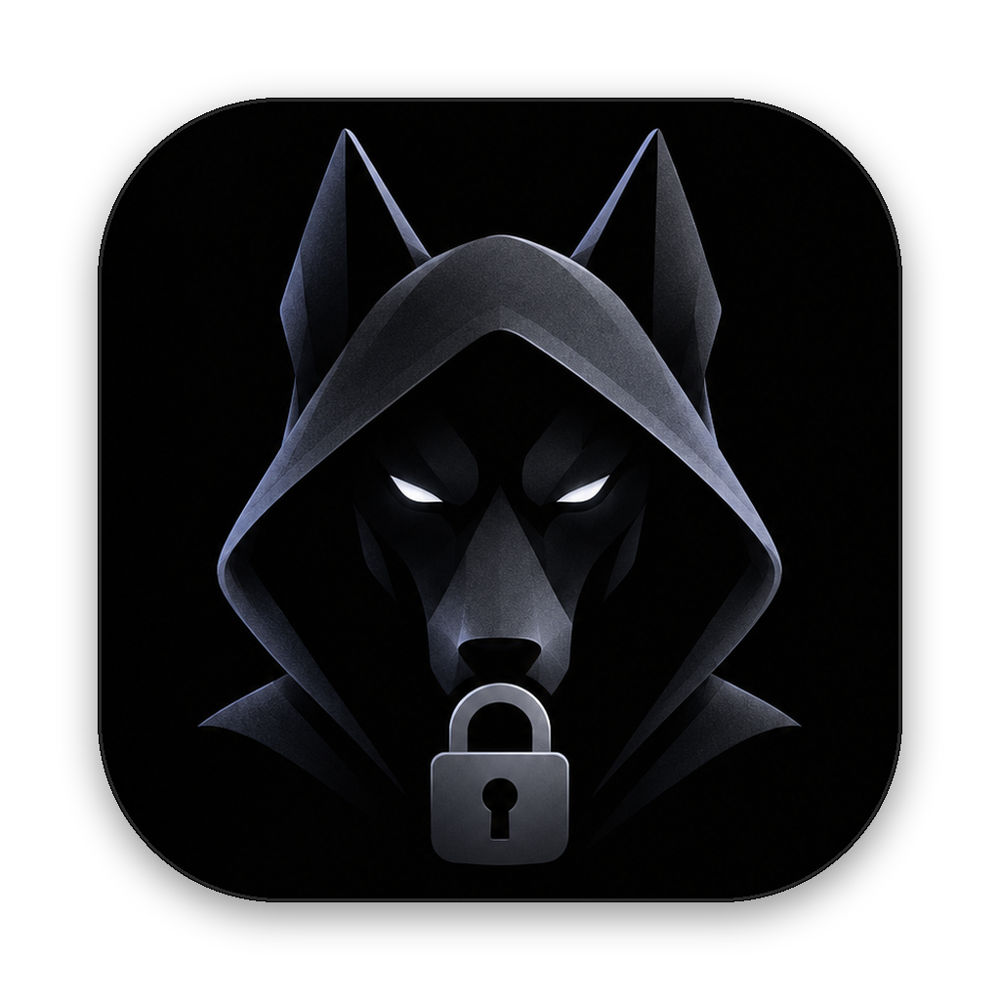

<p align="center"></p>

# Vafa (Verify access for apps) 

**[English version below](#english)**

Не даёт пользоваться выбранными приложениями, пока не включён VPN.
Без VPN приложения **замораживаются** и **не запускаются**; когда VPN
возвращается — всё размораживается само. Значок-щит показывает статус
(`Claude — запуск: разблокировано, процессов: 20`), по клику — выбор приложений.

Щит: 🟢 VPN есть · 🟠 проверяю страну (сеть к Anthropic закрыта) или фильтр не работает ·
🔴 блокировка · ⭕ пустой контур — охрана выключена.

**Claude Code CLI** (macOS) тоже замораживается без VPN — все копии (npm, Homebrew, нативная и
та, что внутри Claude.app), по подписи разработчика, вместе с командами, которые он запустил;
его запуск запрещается. Сессия при этом не сбрасывается: она ждёт и продолжает, когда VPN вернётся
(запрос к API, висевший в момент заморозки, может оборваться — CLI его повторит). Выключить:
`FREEZE_CLI=0` в `/usr/local/etc/vpn-guard.conf`.

## Скачать

| Система | Файл | Установка |
|---|---|---|
| macOS 12+ (Apple Silicon и Intel) | [Vafa-1.0.1.dmg](https://github.com/k33ssa/vafa/releases/download/v1.0.1/Vafa-1.0.1.dmg) | `brew install --cask k33ssa/tap/vafa` |
| Windows 10/11 | [Vafa-1.0.1-windows.zip](https://github.com/k33ssa/vafa/releases/download/v1.0.1/Vafa-1.0.1-windows.zip) | распаковать, `install.cmd` |

Все версии — на странице [Releases](https://github.com/k33ssa/vafa/releases).

---

##  macOS

### Установка

```bash
brew install --cask k33ssa/tap/vafa
```

Homebrew попросит пароль администратора: демон ставится от root.

**Автообновление.** `brew upgrade` подтягивает новые версии. Чтобы Homebrew обновлял всё сам в фоне
(раз в сутки), один раз выполнить:

```bash
brew tap homebrew/autoupdate && brew autoupdate start --upgrade --cleanup --sudo
```

Vafa ставится с паролем администратора, поэтому без `--sudo` фоновое обновление её пропустит; с `--sudo`
пароль спросит окно (нужен `brew install pinentry-mac`).

**Защита во время обновления.** С версии 1.0.1 обновление через Homebrew не снимает защиту: старая версия
останавливается, оставляя сеть к Anthropic закрытой и приложения замороженными, новая подхватывает. Защиту
снимает только настоящее удаление — через 2 минуты после `brew uninstall`. **Обновление с 1.0.0** ещё идёт по
старой схеме (Homebrew удаляет старую версию её же средствами) — на несколько секунд защита снимается: обновляйтесь
с включённым VPN или через DMG (`sudo ./install.sh`).

<details>
<summary>Без Homebrew</summary>

Скачать [Vafa-1.0.1.dmg](https://github.com/k33ssa/vafa/releases/download/v1.0.1/Vafa-1.0.1.dmg),
открыть и в Терминале из открывшегося тома запустить `sudo ./install.sh`.

Или собрать из исходников (нужны Xcode Command Line Tools: `xcode-select --install`):

```bash
cd ~
git clone https://github.com/k33ssa/vafa
cd vafa
./app/build.sh
sudo ./install.sh
```
</details>

Щит сразу появится в строке меню. Если его нет: на macOS 26 — **Системные настройки →
Строка меню → «Разрешить в строке меню» → Vafa** включить; при забитой строке меню значок
может уйти под вырез камеры. Повторный запуск Vafa из «Программ» открывает окно выбора
приложений и без значка. Проверить демон:

```bash
sudo vpn-guard status
```

### Обновление (если уже установлено)

```bash
brew upgrade --cask vafa
```

Ставил из исходников — `cd ~/vafa && git pull && ./app/build.sh && sudo ./install.sh`.

Обновляться лучше при включённом VPN — во время блокировки приложения заморожены.

Что установщик делает при обновлении:

* **настройки и выбранные приложения сохраняет** (`/usr/local/etc/vpn-guard.conf`, выбор в щите);
* **старый список сетей Anthropic** (6 сетей, 2026-09) заменяет нынешним (7 сетей), копия прежнего
  конфига — `/usr/local/etc/vpn-guard.conf.bak.<дата>`; свой список, если ты его правил, не трогает;
* имена телеметрии (`BLOCK_HOSTS`) в старый конфиг не пишет — они и так действуют по умолчанию;
* перезапускает демон и щит; правила pf переезжают в якорь `com.apple/000.vpn-guard`.

Проверить: `sudo vpn-guard status` — при VPN должно быть `VPN: ПОДНЯТ`, а в «Сетевой блок» —
`pass out quick on utunN … keep state (if-bound)`, `block return out quick …` и «фильтр работает».

### Как работает

Системный демон (root) проверяет VPN каждую секунду и **сразу**, как только меняется
сеть (VPN упал, поднялся, переподключился). Если VPN нет:

* **режет сеть** к заданным адресам через pf (по умолчанию — Anthropic и её телеметрия) —
  первым делом, до всего остального;
* **замораживает** процессы приложений (или закрывает — `ON_DOWN=kill`);
* **запрещает запуск** — снимает право на исполнение с файлов в `.app`.

Сеть к Anthropic закрыта по умолчанию: при старте демона, на время перепроверки страны
после любого события сети и пока страна не подтверждена свежим ответом. Когда VPN есть —
только через туннель. Правила pf проверяются каждую секунду и чинятся, если их сбили
(подробно — [docs/ПОДРОБНО.md](docs/ПОДРОБНО.md#сеть-закрыта-по-умолчанию--2026-10-09)).

Настройки: `/usr/local/etc/vpn-guard.conf`, журнал: `/usr/local/var/log/vpn-guard.log`.

### Команды

```bash
sudo vpn-guard status      # что сейчас происходит
sudo vpn-guard check       # только проверка VPN и страны
sudo vpn-guard unlock      # аварийно снять всё (выключает охрану)
sudo vpn-guard uninstall   # удалить демон
brew uninstall --cask vafa # если ставил через Homebrew — удалит демон и Vafa.app
```

`unlock` останавливает демон, снимает блокировку и сетевой блок — охрана выключена и после
перезагрузки. Включить снова: в щите «Охрана включена».

Перенести на другой Мак без сборки: `./make-dmg.sh` → [INSTALL.md](INSTALL.md).

---

##  Windows 10/11

### Установка

1. Скачать [Vafa-1.0.1-windows.zip](https://github.com/k33ssa/vafa/releases/download/v1.0.1/Vafa-1.0.1-windows.zip), распаковать.
2. В папке `Vafa-windows` дважды щёлкнуть **`install.cmd`** → разрешить в окне UAC.

Щит появится в трее (в Windows 11 новые значки по умолчанию прячутся под стрелку **^** у
часов). Чтобы он был виден всегда: **Параметры → Персонализация → Панель задач → Другие
значки в области уведомлений** — щит там, скорее всего, называется **Windows PowerShell** (трей запускается
через PowerShell), или просто перетащить его из-под **^** на панель.
Двойной щелчок по щиту — окно выбора приложений.

### Обновление (если уже установлено)

1. Скачать свежий `Vafa-<версия>-windows.zip` со страницы [Releases](https://github.com/k33ssa/vafa/releases/latest)
   и распаковать (поверх старой папки или в новую — неважно).
2. В папке `Vafa-windows` дважды щёлкнуть **`install.cmd`** → разрешить в окне UAC.
3. Дождаться «Установлено» и нажать любую клавишу.

Лучше обновляться **при включённом VPN**: во время блокировки приложения заморожены.

Что установщик делает при обновлении:

* **настройки и выбранные приложения сохраняет** (`C:\ProgramData\VPNGuard\config.json`);
* **включает сетевой блок**, если его не было: раньше `block_nets` по умолчанию был пустым — Claude
  Code и claude.ai в браузере ничем не закрывались. Пустой или прежний список из 6 сетей заменяется
  на нынешний (7 сетей Anthropic), добавляется `block_hosts` (её облачные адреса и телеметрия:
  Sentry, Datadog, Intercom). Свой список, если ты его правил, не трогается;
* **добавляет страны блокировки** RU CN BY IR, если их ещё нет в конфиге (к прежнему `geo:!RU`);
* **останавливает старую службу** (и сторожа, и сам демон) и ставит новую задачу Планировщика;
* **закрывает старый щит в трее** и запускает новый.

Проверить после обновления — PowerShell **от администратора**:

```powershell
& "C:\Program Files\VPNGuard\vpn-guard.ps1" status
```

При включённом VPN должно быть `VPN: ПОДНЯТ`, в разделе «Брандмауэр» — правило `VPNGuard-Block`
(в «интерфейсы» перечислены все адаптеры, кроме VPN) и строка
`по данным службы: состояние up, режим «via:<VPN-адаптер>», фильтр работает`.

### Как работает

Служба — задача Планировщика от SYSTEM: стартует при загрузке Windows, ещё до входа в систему.
Внутри — сторож (`supervise`): он держит демона и перезапускает его через 2 с, если тот упал или
завис (не обновлял статус 30 с); саму задачу Планировщик поднимает раз в минуту, если умер и сторож.

Демон проверяет VPN каждую секунду и сразу при смене адресов сети. VPN засчитан, когда:

* выход в интернет (маршрут к 1.1.1.1) идёт через **туннель** — адаптер VPN, а не провайдера;
  туннель узнаётся по имени и описанию адаптера (WireGuard, Wintun, TAP, OpenVPN, AmneziaVPN,
  Outline, Happ, sing-box, v2ray/xray, Clash, Hiddify, NordLynx, WARP, AnyConnect и т.п.).
  **PPPoE («Высокоскоростное подключение»), мост, Tailscale, ZeroTier — не туннель;**
* маршрут к адресам Anthropic тоже идёт в туннель (IPv6 мимо туннеля допустим, если брандмауэр
  точно закрывает IPv6-адреса Anthropic на всех интерфейсах);
* Cloudflare видит выход **не из стран блокировки**. Страну служба спрашивает **только через
  туннель** и только по IP (1.1.1.1, 1.0.0.1), без DNS и прокси — ни одного запроса с настоящего
  адреса. Имена из `block_hosts` резолвятся через DoH (1.1.1.1) с адреса туннеля; если VPN-клиент
  подменяет адреса (fake-IP, 198.18.0.0/15), при блокировке закрывается и этот диапазон.

Три состояния (видны в щите и в `status`):

| состояние | сеть к Anthropic | приложения |
|---|---|---|
| **up** — VPN засчитан | только через туннель: блок на всех остальных интерфейсах | работают |
| **unsure** — туннель есть, страна ещё не подтверждена (сразу после смены сети, Cloudflare молчит) | закрыта | не трогаются; молчит дольше 60 с (`geo_stale`) — down |
| **down** — VPN нет | закрыта везде — первым делом | заморожены (или закрыты — `"on_down": "kill"`), запуск `.exe` запрещён |

Сетевой блок — правило Брандмауэра Windows `VPNGuard-Block`: сначала ставится новое, потом убирается
старое (ни мгновения без правила). Раз в 5 с и сразу после любого изменения служба проверяет, что
правило на месте и включено, что брандмауэр работает во всех профилях и ни один интерфейс не
исключён из защиты; иначе чинит и пишет в журнал, а щит показывает «НЕ ЗАЩИЩЕНА».

Нагрузка (замер в VM): служба ~4 % одного ядра, WMI ~3 %.

Настройки: `C:\ProgramData\VPNGuard\config.json`, журнал — там же, `vpn-guard.log` (или в щите
«Открыть журнал»). Состояние для щита — `status.json` там же.

**Если с включённым VPN всё равно блокирует** — запустить `check` (команда ниже). Строка
`интерфейс выхода: <имя> — <описание>` показывает адаптер, через который идёт интернет; если при
этом `[ нет] route`, а в журнале — `выход через <имя> — не туннель`, значит адаптер этого VPN не
узнан по имени. Напиши эти имя и описание — добавим. Если VPN в режиме системного прокси, а не
туннеля, — см. «Какой VPN подходит».

### Команды (PowerShell от администратора)

```powershell
& "C:\Program Files\VPNGuard\vpn-guard.ps1" status   # что сейчас происходит
& "C:\Program Files\VPNGuard\vpn-guard.ps1" check    # только проверка VPN и страны
& "C:\Program Files\VPNGuard\vpn-guard.ps1" unlock   # аварийно снять всё (выключает охрану)
```

`unlock` снимает блокировку, размораживает приложения и **выключает задачу Планировщика** —
охрана не вернётся сама. Включить снова: в трее «Охрана включена» или
`Enable-ScheduledTask VPNGuard; Start-ScheduledTask VPNGuard`.

Удалить: в распакованной папке `Vafa-windows` —

```powershell
powershell -ExecutionPolicy Bypass -File .\uninstall.ps1
```

---

## Какой VPN подходит

Проверка по умолчанию на обеих системах: **весь трафик идёт через туннель** и
**Cloudflare видит выход не из страны блокировки**.

## Страны блокировки

По умолчанию VPN считается выключенным, если интернет видит тебя из
🇷🇺 России, 🇨🇳 Китая, 🇧🇾 Беларуси или 🇮🇷 Ирана. Список меняется в щите:
**«Выбрать страны…»** — поиск по названию или коду, кнопка «По умолчанию».

Страна выхода проверяется:

* сразу при любом изменении сети (macOS — `route -n monitor`, Windows — событие
  смены адресов): переподключился VPN — через полсекунды страна уже известна, а до
  ответа сеть к Anthropic закрыта;
* и каждую секунду — это ловит смену сервера внутри уже поднятого туннеля, когда
  сеть событий не даёт (реже — `GEO_TTL` в конфиге).

Страну спрашивают **через сам туннель**; если маршрут не через туннель, не спрашивают
вовсе — ни одного запроса с настоящего адреса.

Нагрузка по замеру (2026-10-09): macOS — ~4 % одного ядра вместе со всеми запусками curl и pfctl
(33 процесса приложения под охраной), Windows — служба ~4 % и WMI ~3 %; запрос к Cloudflare — 1 КБ.
Тесты: `./tests/run_macos.sh` (без root и без интернета), `tests/run_windows.ps1` (в VM).

*  Подходит любой VPN в режиме туннеля: Happ, OpenVPN, WireGuard, Outline,
  AmneziaVPN, встроенный IKEv2 и т.п.
*  VPN в режиме **системного прокси** (Happ/V2Ray/Clash «Proxy», без туннеля) на macOS
  засчитывается, если порт прокси на 127.0.0.1 слушает известный VPN-клиент (xray, sing-box,
  Clash…), а страна, спрошенная через этот прокси, не из списка блокировки. Напрямую к Anthropic
  при этом закрыто — работает только то, что ходит через системный прокси (Claude.app — да,
  Claude Code CLI — нет). На Windows пока нет — там нужен режим туннеля (TUN).
   * Прокси засчитывается **только на 127.0.0.1** — то есть программа на этом же Маке. Прокси на
     чужом адресе (сервер в сети, прокси провайдера или работы) — не VPN-клиент, его выход не
     проверить: такой не засчитывается. Программы, которые тоже ставят системный прокси на
     127.0.0.1, но не прячут страну (Charles, Proxyman, рабочие фильтры вроде Zscaler), не
     засчитываются: Vafa смотрит, какой процесс держит порт.
*  Два VPN сразу (например, рабочий OpenVPN и Happ): решает тот, через который идёт маршрут к
  адресам Anthropic, — страна проверяется через него же. Рабочий VPN обычно забирает только свои
  сети (10.x), и Anthropic идёт через Happ. Если рабочий VPN заберёт весь трафик, а выходит он из
  страны блокировки, — будет блокировка (а не утечка).
*  С раздельным туннелированием, где Anthropic идёт мимо туннеля, охрана считает, что VPN нет.
  Для особых случаев есть правила `proc:`, `nc:`/`adapter:`, `script:` — см.
  [docs/ПОДРОБНО.md](docs/ПОДРОБНО.md).

## Файлы

| путь | что это |
|---|---|
| `vpn-guard`, `vpn-guard.conf`, `local.vpnguard.plist`, `install.sh` | macOS: демон, настройки, автозапуск, установка |
| `app/` | macOS: приложение-щит (Swift) и `build.sh` |
| `make-dmg.sh` | macOS: собрать `Vafa.dmg` |
| `windows/` | Windows: служба, трей, `install.cmd`, `uninstall.ps1` |
| `INSTALL.md` | подробная установка для обеих систем |
| `tests/` | тесты: `run_macos.sh` (без root и интернета), `run_windows.ps1` (в VM от администратора) |

---

<a id="english"></a>

## English

**Vafa (Verify access for apps)** is a free, open-source VPN kill switch for macOS and Windows. It keeps chosen apps (Claude, VLC, anything you pick) frozen and unable to launch, and blocks their network, until a VPN with an allowed exit country is up. When the VPN comes back, everything unfreezes on its own. A shield in the menu bar or system tray shows the status; click it to pick apps and blocked countries.

Shield: green — VPN is up · orange — checking the exit country (network to the protected hosts is closed) or the filter is broken · red — blocked · empty outline — protection is off.

### Download

| Platform | File | Install |
|---|---|---|
| macOS 12+ (Apple Silicon and Intel) | [Vafa-1.0.1.dmg](https://github.com/k33ssa/vafa/releases/download/v1.0.1/Vafa-1.0.1.dmg) | `brew install --cask k33ssa/tap/vafa` |
| Windows 10/11 | [Vafa-1.0.1-windows.zip](https://github.com/k33ssa/vafa/releases/download/v1.0.1/Vafa-1.0.1-windows.zip) | unzip, run `install.cmd` |

All versions: [Releases](https://github.com/k33ssa/vafa/releases).

### macOS

```bash
brew install --cask k33ssa/tap/vafa
```

Homebrew asks for the admin password because the daemon runs as root. Without Homebrew: open the DMG and run `sudo ./install.sh` from the mounted volume.

- Update: `brew upgrade --cask vafa`
- Automatic background updates: `brew tap homebrew/autoupdate && brew autoupdate start --upgrade --cleanup --sudo` (Vafa needs the admin password, so without `--sudo` background updates skip it; `--sudo` asks in a dialog and needs `brew install pinentry-mac`)
- Updating keeps the protection on since 1.0.1: the old version stops with the network to Anthropic closed and apps frozen, the new one takes over; only a real `brew uninstall` lifts it (after 2 minutes). Updating **from 1.0.0** still uses the old uninstall and lifts protection for a few seconds — update with the VPN on, or via the DMG (`sudo ./install.sh`).
- Status: `sudo vpn-guard status`
- Uninstall: `brew uninstall --cask vafa`

If the shield does not appear on macOS 26, enable Vafa in System Settings -> Menu Bar -> Allow in the Menu Bar.

### Windows

1. Download [Vafa-1.0.1-windows.zip](https://github.com/k33ssa/vafa/releases/download/v1.0.1/Vafa-1.0.1-windows.zip) and unzip it.
2. In `Vafa-windows`, double-click `install.cmd` and accept the UAC prompt.

The shield appears in the tray (on Windows 11 it may hide under the ^ arrow); double-click it to choose apps. To update, download the newer zip and run `install.cmd` again: your settings and app list are kept. To uninstall, run `powershell -ExecutionPolicy Bypass -File .\uninstall.ps1` from an admin PowerShell in that folder.

### How it works

A system service (root daemon on macOS, a SYSTEM scheduled task on Windows) checks the VPN every second and immediately on any network change. The VPN counts only when internet traffic goes through a tunnel adapter and Cloudflare, asked through that tunnel, sees an exit outside the blocked countries (Russia, China, Belarus and Iran by default; change them in the shield). Without a valid VPN it:

- blocks network access to the protected hosts first (pf on macOS, Windows Firewall rule `VPNGuard-Block` on Windows; Anthropic networks and telemetry by default);
- freezes the chosen apps (or quits them with `ON_DOWN=kill`);
- prevents them from launching.

The network to the protected hosts is closed by default: at startup, while the exit country is being re-checked after a network event, and until a fresh answer confirms it. The firewall rules are verified every second and repaired if something removes them. The country check never goes out through your real address.

Any tunnel-mode VPN works: WireGuard, OpenVPN, Outline, AmneziaVPN, Happ, built-in IKEv2 and others. On macOS a system-proxy VPN (xray, sing-box, Clash on 127.0.0.1) is also accepted. Split tunneling that sends the protected hosts outside the tunnel counts as no VPN.

Config: `/usr/local/etc/vpn-guard.conf` (macOS), `C:\ProgramData\VPNGuard\config.json` (Windows). Detailed notes (Russian): [docs/ПОДРОБНО.md](docs/ПОДРОБНО.md).
